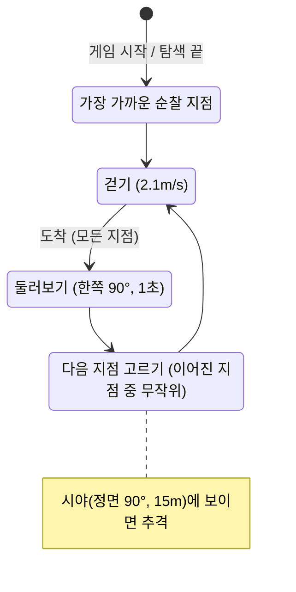
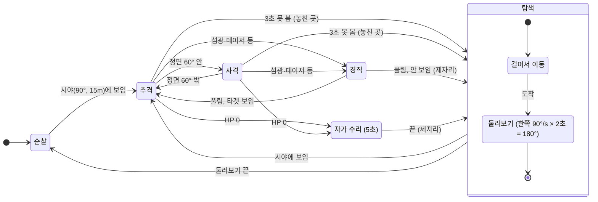
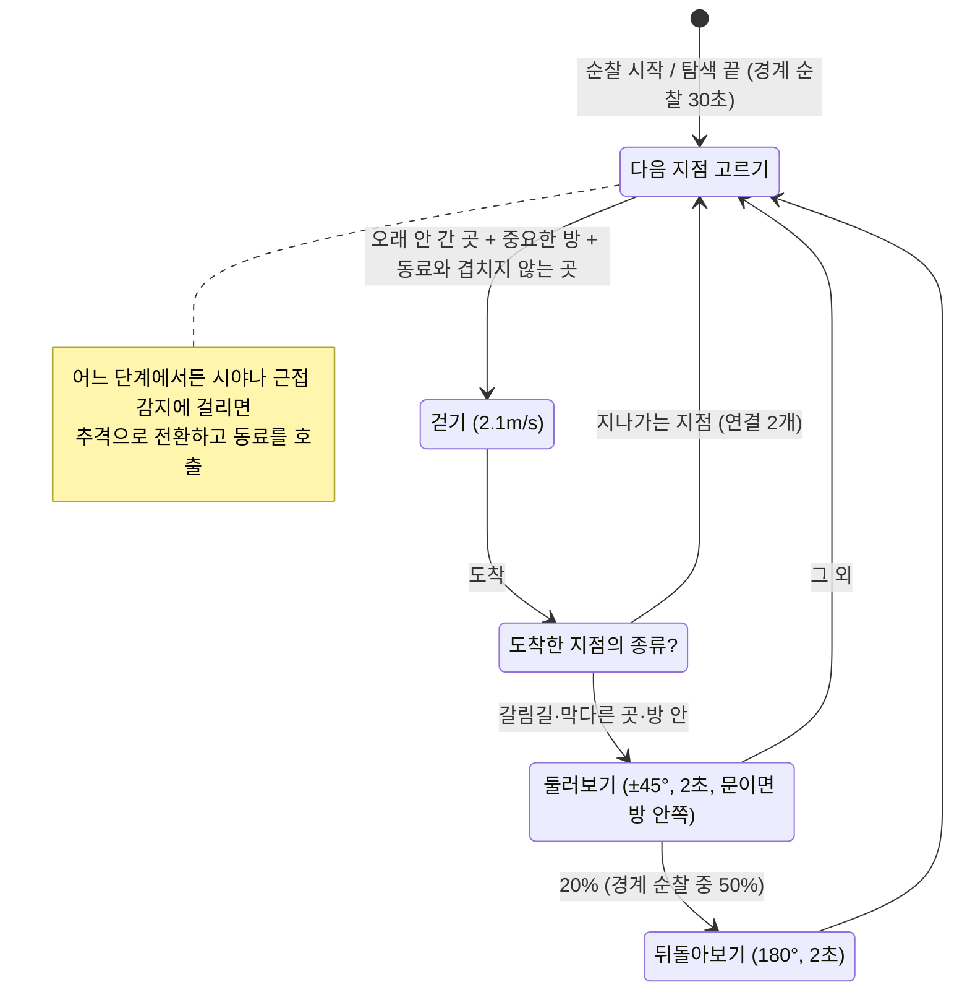
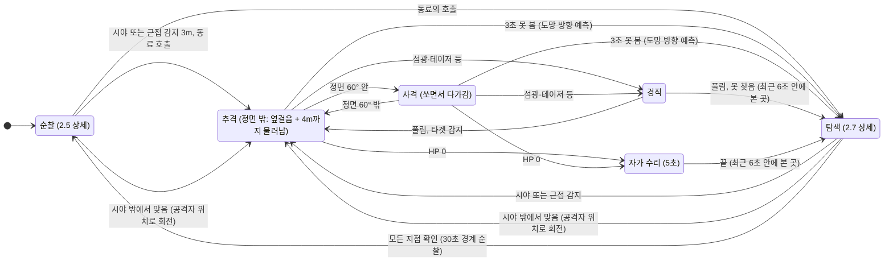
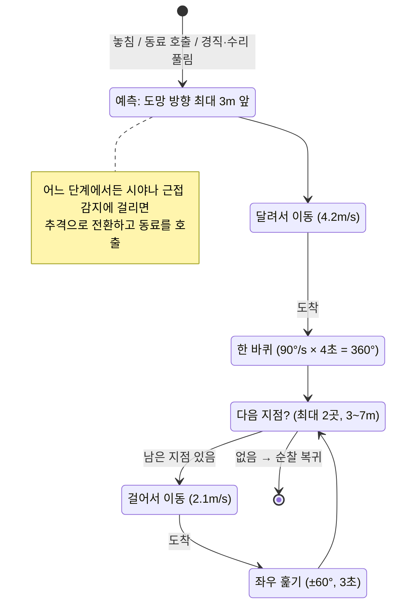

# 경비원 AI: 공격·탐색·순찰 현재 방식과 개선안

> 상태: **검토용 제안서** (코드 미반영)
> 대상 코드: `Content/Game/GuardAI.cpp`, 수치: `Content/GameData.h`
> 전제: **경비원 회전 속도는 항상 초당 90°로 고정** (기획 N-04). 순찰·추격·사격·탐색 모두 같은 속도로 돕니다.
> 순찰 데이터: `Data/Maps/mansion_1f_server.json` (`tools/collision_to_map.py`가 생성)
> 다이어그램은 Mermaid로 작성했습니다 (GitHub, VS Code의 Mermaid 미리보기 확장에서 그림으로 보입니다).

---

## 0. 한눈에 보기

| 구분 | 현재 문제 | 개선 방향 |
|---|---|---|
| 공격 | 등 뒤로 돌거나 주위를 돌면서 때리면 경비원이 따라 돌지 못함 | **회전 속도(초당 90°)는 그대로** 두고, 근접 감지·피격 위치 파악·옆걸음·거리 벌리기로 대응 |
| 탐색 | 놓친 자리 한 곳에서 반 바퀴(180°)만 보고 순찰 복귀 | 도망 방향 예측, 한 바퀴(360°), 주변 지점 추가 확인, 동료 호출 |
| 순찰 | 완전 무작위라 5분 동안 방의 절반 정도만 돌고, 모든 지점에서 멈추며 뒤를 보지 않음 | 오래 안 간 곳 우선, 동료와 분담, 지나가는 지점은 통과, 중요한 방 가중치, 가끔 뒤돌아보기 |

---

## 1. 현재 방식

### 1.1 감지 (플레이어를 알아채는 방법)

| 항목 | 값 |
|---|---|
| 탐지 범위 | 반지름 15m |
| 시야각 | 정면 90° (좌우 45°) |
| 벽 검사 | 경비원 눈(160cm) → 플레이어 가슴(100cm) 사이에 벽이 있으면 못 봄 |
| 감지 못 하는 대상 | 은신, 연막 안, 쓰러짐, 리스폰 무적 |
| 등 뒤 | **감지 수단 없음**: 바로 뒤에 붙어 있어도 모름 |

### 1.2 공격 방식

| 항목 | 현재 동작 |
|---|---|
| 공격 조건 | 타겟이 정면 60° (좌우 30°) 안, 15m 이내 |
| 사격 | 0.1초마다 1발, 타겟 방향 ±30° 안에서 무작위 방향 (난사). 1발 10 대미지, 처음 맞은 플레이어 1명 |
| 이동 | 쏘면서 달리기 속도(4.2m/s)로 계속 다가감. 몸이 닿으면 멈춤 |
| 회전 | **항상 초당 90°** (순찰·추격·사격 모두 같음) |
| 공격 범위 밖 | 시야 안이지만 정면 60° 밖이면 초당 90°로 돌아서 맞춘 뒤 사격 |
| 놓침 | 3초 동안 안 보이면 탐색으로 전환. 그동안은 마지막으로 본 곳으로 달려감 |
| 타겟 규칙 | 처음 발견한 사람 유지, 동시에 보이면 가까운 쪽 (N-13, N-14) |
| 다른 사람이 공격 | 즉시 그 사람으로 타겟 변경, 시야에서 벗어나기 전까지 고정 (N-15, N-16) |
| **지금 타겟이 공격** | **아무 반응 없음** (위치 갱신도, 돌아서기도 안 함) |
| 자가 수리 | HP 0 → 5초 무적·정지 → HP 200 |
| 경직 | 섬광탄 2초, 제트팩 1초, 테이저·감전 지뢰 2초 동안 아무것도 못 함 |

### 1.3 탐색 방식

| 항목 | 현재 동작 |
|---|---|
| 탐색 시작 위치 | 추격 중 놓침 → 마지막으로 본 곳. 경직·수리 후 → **제자리** |
| 이동 | 탐색 지점까지 **걷기**(2.1m/s) |
| 둘러보기 | 도착하면 **한쪽 방향으로만** 초당 90° × 2초 = **180°** |
| 확인 지점 수 | **1곳** |
| 끝나면 | 가장 가까운 순찰 지점으로 순찰 복귀 |
| 동료 | 다른 경비원과 정보 공유 없음 |

### 1.4 순찰 방식

| 항목 | 현재 동작 |
|---|---|
| 순찰 지점 | **156개**, 연결 **182개**, 연결 간 평균 약 6.1m (최대 14.3m). 방 안 80개(방 중심 + 40㎡ 넘는 방은 7m 간격), 방 사이 문 37개, 복도 39개 |
| 지점의 연결 수 | 막다른 곳(1개) 21개 · **지나가는 곳(2개) 78개** · 갈림길(3개 이상) 57개 |
| 시작 | 각자 스폰 위치에서 가장 가까운 순찰 지점 |
| 이동 | 경로 찾기(A*)로 다음 지점까지 걷기(2.1m/s). 진행 방향으로 90°/s 회전 |
| 지점 도착 | **모든 지점에서** 멈춰서 한쪽으로 1초 회전 = 90° |
| 다음 지점 | 이어진 지점 중 **완전 무작위**. 방금 온 곳은 막다른 길일 때만 |
| 경비원끼리 | 서로 어디 있는지, 어디를 돌았는지 모름 |
| 게임 상황 | 금고·반납 지점·보물 위치와 관계없이 돎 |
| 탐색 후 | 가장 가까운 지점부터 다시 무작위 순찰 |

**5분 동안 얼마나 도나** (경비원 3명, 순찰 지점 그래프로 단순화한 시뮬레이션 200회 평균)

| 항목 | 결과 |
|---|---|
| 방문한 순찰 지점 | 약 59% |
| 방문한 방 (복도·문 제외 31곳) | **약 52%**, 운이 나쁘면 23% |
| 멈춰 있는 시간 | 지점마다 약 2.9초 걷고 1초 멈춤 → 순찰 시간의 약 1/4 |

※ 기획서 N-19의 "순찰 지점 47개"는 예전 값이고, 지금 맵 데이터는 156개입니다.

### 1.5 현재 상태 다이어그램

### 1.6 현재 방식의 약점

**공격**
1. **주위를 돌면 따라 돌지 못함.** 경비원 주위를 도는 각속도는 `이동 속도 ÷ 거리`입니다.

   | 플레이어 | 거리 2m | 거리 3m |
   |---|---|---|
   | 걷기 3m/s | 약 86°/s | 약 57°/s |
   | 달리기 6m/s | **약 172°/s** | 약 115°/s |

   경비원은 90°/s라서, 가까이 붙어서 달리며 돌면 영원히 정면에 들어오지 않습니다.
2. **등 뒤를 감지하지 못함.** 시야가 정면 90°뿐이라 뒤에 붙은 플레이어는 처음부터 발견되지 않습니다.
3. **지금 타겟이 뒤에서 때리면 무반응.** 다른 플레이어가 때리면 반응하지만, 쫓던 상대가 뒤로 돌아 때리면 위치 정보도 갱신하지 않습니다.
4. **돌아서는 데 오래 걸림.** 180° 돌아서는 데 2초가 걸리고, 그 사이 플레이어는 계속 뒤로 돌 수 있습니다.

**탐색**
1. **반쪽만 봄.** 2초 × 90°/s = 180°라서 반대편에 숨으면 들키지 않습니다.
2. **한 곳만 확인.** 놓친 지점에서 둘러보고 바로 순찰로 돌아갑니다.
3. **도망 방향을 무시.** 플레이어는 계속 움직였는데 정확히 놓친 자리만 확인합니다.
4. **느리게 도착.** 걸어서 오는 동안 플레이어가 멀리 갑니다.
5. **경직·수리 후 제자리 탐색.** 섬광탄이나 테이저를 쓴 플레이어가 있던 쪽을 활용하지 않습니다.
6. **혼자 탐색.** 근처 경비원은 아무것도 모릅니다.

**순찰**
1. **골고루 돌지 못함.** 다음 지점을 완전 무작위로 고르기 때문에 같은 구역을 맴돌고, 5분 동안 방의 절반 정도만 갑니다.
2. **경비원끼리 겹침.** 서로 위치를 몰라서 같은 구역에 몰리고, 다른 구역은 비어 있을 수 있습니다.
3. **쓸데없이 자주 멈춤.** 복도 중간처럼 연결이 2개뿐인 지나가는 지점(78개)에서도 멈추기 때문에 순찰 시간의 1/4이 정지입니다.
4. **둘러보기가 좁음.** 한쪽으로 90°만 돌아서 반대쪽 옆은 보지 않습니다. 방 입구에서도 방 안쪽을 보지 않을 수 있습니다.
5. **중요한 곳을 신경 쓰지 않음.** 금고가 있는 방이나 반납 지점 근처를 일부러 지키지 않습니다.
6. **뒤를 보지 않음.** 시야가 정면뿐이고 진행 방향만 보므로, 경비원 뒤를 따라다니며 움직이기 쉽습니다.
7. **놓친 직후에도 평소대로.** 탐색이 끝나면 그 근처를 더 경계하지 않고 바로 무작위 순찰로 돌아갑니다.

---

## 2. 개선안

항목마다 따로 넣고 뺄 수 있습니다. 괄호 안은 조정용 수치(제안값)입니다.
**모든 항목에서 회전 속도는 초당 90° 그대로입니다.**

### 2.1 회전 속도를 바꾸지 않고 따라잡는 원리

경비원 주위를 도는 플레이어의 각속도는 `(플레이어 속도 − 경비원이 같은 방향으로 움직인 속도) ÷ 거리`입니다. 이 값이 90°/s보다 작으면 경비원이 같은 속도로 돌아도 결국 정면에 들어옵니다. 회전을 건드리지 않고 이 값을 줄이는 방법은 두 가지입니다.

1. **거리 늘리기**: 90°/s보다 빨리 돌 수 있는 거리는 걷기(3m/s)면 약 1.9m 안, 달리기(6m/s)면 약 3.8m 안입니다. 4m 넘게 떨어지면 달려도 따돌릴 수 없습니다.

   | 플레이어 | 2m | 3m | **4m** |
   |---|---|---|---|
   | 걷기 3m/s | 86°/s | 57°/s | 43°/s |
   | 달리기 6m/s | 172°/s | 115°/s | **86°/s** |

2. **같은 방향으로 옆걸음**: 플레이어가 도는 방향으로 경비원도 옆으로 움직이면 상대 속도가 줄어듭니다. 플레이어가 달리기 6m/s, 경비원이 4.2m/s로 같이 움직이면 상대 속도는 1.8m/s입니다. 2m 거리에서 약 52°/s라서 90°/s로도 따라잡습니다.

### 2.2 공격 개선

| 번호 | 개선 | 내용 | 노리는 효과 |
|---|---|---|---|
| A-1 | 근접 감지 | 3m 안은 방향과 상관없이(360°) 감지. 벽 너머는 못 봄 (`3m`) | 등 뒤에 붙어 있으면 들킴. 감지되면 위치가 계속 갱신되어 A-2·A-3이 작동 |
| A-2 | 피격 위치 파악 | 시야 밖에서 맞으면 공격자 위치를 알고 그쪽으로 돌기 시작(90°/s, 가까운 방향). 놓침 타이머(3초)도 다시 셈. **지금 타겟이 때린 경우도 포함**(현재는 무반응) | 뒤에서 때리면 반드시 돌아섬. 맞을수록 위치를 계속 알게 됨 |
| A-3 | 옆걸음 추적 | 타겟이 정면 60° 밖이면 다가가는 대신, 타겟이 도는 방향으로 옆걸음(최대 달리기 4.2m/s) (`타겟 이동 속도를 따라감`) | 상대 각속도를 줄여 90°/s로도 정면에 넣음 |
| A-4 | 거리 벌리기 | 타겟이 4m 안인데 정면 60° 밖이면 뒤로 물러남. A-3과 함께 쓰면 비스듬히 뒤로 물러나는 움직임 (`4m`) | 4m 밖에서는 달려도 90°/s보다 빨리 못 돎 |
| A-5 | (선택) 근거리 공격 범위 확대 | 3m 안의 타겟은 공격 범위를 정면 60°에서 시야각과 같은 90°로 넓힘 (`3m`, `90°`) | 바짝 붙은 상대를 더 빨리 쏨. **기획 12.2의 공격 범위가 바뀌므로** 필요할 때만 |

A-3·A-4는 정면 60° 밖일 때만 작동합니다. 정면에 들어오면 지금처럼 쏘면서 다가갑니다.

### 2.3 탐색 개선

| 번호 | 개선 | 내용 | 노리는 효과 |
|---|---|---|---|
| S-1 | 도망 방향 예측 | 추격 중 플레이어 이동 속도를 기억. 놓치면 그 방향으로 1초 앞(최대 3m) 지점부터 탐색. 벽에 막히면 놓친 곳 그대로 (`3m`) | 모퉁이를 돌아 숨은 플레이어를 찾음 |
| S-2 | 첫 지점은 달려감 | 첫 탐색 지점까지 달리기(4.2m/s), 이후는 걷기 | 도망칠 시간을 줄임 |
| S-3 | 한 바퀴 둘러보기 | 첫 지점에서 90°/s × 4초 = 360° (`4초`) | 반대편 사각지대 제거 |
| S-4 | 주변 지점 추가 확인 | 놓친 곳에서 3~7m 떨어진 걸을 수 있는 지점 중 도망 방향 쪽 우선으로 최대 2곳. 실제 경로가 있고 직선 거리의 2배 이상 돌아가지 않는 곳만. 각 지점에서 왼쪽 60° → 오른쪽 60° → 가운데 훑기, 90°/s로 3초 (`2곳`, `3~7m`, `±60°`) | 근처 방·구석까지 확인 |
| S-5 | 동료 호출 | 경비원이 플레이어를 발견하면 20m 안에서 순찰·탐색 중인(전투·경직·수리 중 제외) 동료가 그 위치로 탐색하러 옴 (`20m`) | 혼자 따돌려도 다른 경비원이 합류 |
| S-6 | 경직·수리 후 기억 | 풀렸을 때 타겟이 안 보이면, 최근 6초 안에 본 곳이 있으면 그곳을 탐색 (`6초`) | 섬광탄·테이저 후 도망쳐도 쫓아옴 |

### 2.4 순찰 개선

| 번호 | 개선 | 내용 | 노리는 효과 |
|---|---|---|---|
| P-1 | 오래 안 간 곳 우선 | 지점마다 마지막으로 누가 다녀간 시각을 3명이 함께 기록. 다음 지점은 이어진 지점 중 가장 오래 안 간 곳을 고름. 똑같이 예측되지 않도록 약간의 무작위를 섞음 (`무작위 폭 20초`) | 같은 곳 맴돌기 방지, 맵 전체를 골고루 |
| P-2 | 동료와 겹치지 않기 | 다른 경비원이 지금 가고 있는 지점은 방금 다녀간 것으로 침. 동료가 10m 안에 있으면 그쪽 방향 지점은 뒤로 미룸 (`10m`) | 3명이 자연스럽게 다른 구역으로 흩어짐 |
| P-3 | 지나가는 지점은 통과 | 연결이 2개뿐인 지점(복도 중간 등 78개)에서는 멈추지 않고 그대로 지나감. 갈림길·막다른 곳·방 안 지점에서만 둘러봄 | 멈추는 시간이 줄어 더 넓게 돎 |
| P-4 | 둘러보기 개선 | 한쪽 90° 대신 왼쪽 45° → 오른쪽 45° → 가운데, 90°/s로 2초. 방 입구(문 지점)에서는 방 안쪽을 가운데로 놓고 훑음 (`±45°`, `2초`) | 양옆과 방 안을 확인 |
| P-5 | 중요한 방 가중치 | 금고가 있는 방, 반납 지점이 열린 방 쪽 지점은 "더 오래 안 간 것"으로 쳐서 더 자주 들름. 경비원이 지키는 시설이라 위치를 아는 것으로 봄 (소리를 듣는 것 아님, N-17 유지) (`가중치 30초`) | 플레이어가 노리는 곳의 경계 강화 |
| P-6 | 가끔 뒤돌아보기 | 지점에서 둘러볼 때 일정 확률로 왔던 방향을 2초 동안 돌아봄 (90°/s로 180°) (`20%`) | 경비원 뒤를 따라다니기 어려워짐 |
| P-7 | 경계 순찰 | 탐색을 마쳐도 30초 동안은 놓친 곳 15m 안의 지점을 우선해서 돌고, 뒤돌아보기 확률을 높임 (`30초`, `15m`, `50%`) | 숨었다가 바로 나오는 플레이어를 잡음 |
| P-8 | (선택) 걸으며 두리번 | 8m 넘게 걷는 구간에서 중간에 한 번 왼쪽이나 오른쪽으로 30° 고개를 돌렸다가 돌아옴 (90°/s, 약 0.7초) (`8m`, `30°`) | 긴 복도 양옆 방 입구 확인. 그 순간 정면 감지는 약해지므로 선택 |

**시뮬레이션으로 본 효과** (1.4와 같은 방식, 200회 평균. P-1·P-2·P-3을 넣고 갈림길에서 2초 둘러봄)

| 항목 | 현재 | 개선 |
|---|---|---|
| 5분 동안 방문한 순찰 지점 | 약 59% | **약 80%** |
| 5분 동안 방문한 방 | 약 52% (최악 23%) | **약 73%** (최악 48%) |

그래프만으로 단순화한 계산이라 실제 게임에서는 차이가 날 수 있습니다. 방향을 비교하는 용도로만 보세요.

### 2.5 개선 후 순찰 상세

### 2.6 개선 후 상태 다이어그램

새 상태는 없습니다. 기존 상태 안에서 움직임과 전환 조건만 바뀝니다.

추격·사격 중 시야 밖에서 맞으면 상태는 그대로이고, 타겟 위치만 공격자 위치로 갱신됩니다(A-2).

### 2.7 개선 후 탐색 상세

---

## 3. 현재 대비 비교

| 항목 | 현재 | 개선안 |
|---|---|---|
| 회전 속도 | 90°/s | 90°/s (변경 없음) |
| 등 뒤 감지 | 없음 | 3m 안 360° |
| 지금 타겟이 뒤에서 때림 | 무반응 | 공격자 위치로 회전 시작 |
| 바짝 붙어 돌기 (달리기, 2m) | 172°/s로 돌아 못 따라감 | 옆걸음으로 약 52°/s, 물러나면 4m에서 86°/s → 따라잡음 |
| 탐색 첫 지점 | 놓친 자리 | 도망 방향 최대 3m 앞 |
| 탐색 이동 속도 | 걷기 | 첫 지점 달리기 |
| 둘러보는 범위 | 180° | 360° + 주변 지점마다 ±60° |
| 확인 지점 | 1곳 | 최대 3곳 |
| 탐색 시간 (대략) | 이동 + 2초 | 이동 + 약 16초 (4초 + 2곳 × (이동 약 3초 + 훑기 3초)) |
| 경직·수리 후 | 제자리 | 최근 본 곳 |
| 동료 | 없음 | 20m 안 동료가 합류 |
| 순찰 다음 지점 | 완전 무작위 | 오래 안 간 곳·중요한 방 우선, 동료와 분담 |
| 순찰 중 멈추는 곳 | 모든 지점 (156개) | 갈림길·막다른 곳·방 안 (78개) |
| 순찰 둘러보기 | 한쪽 90°, 1초 | 좌우 ±45°, 2초 (문에서는 방 안쪽) + 가끔 뒤돌아보기 |
| 5분 동안 방문한 방 (시뮬레이션) | 약 52% | 약 73% |
| 탐색 직후 | 바로 평소 순찰 | 30초 동안 근처 경계 순찰 |

---

## 4. 검토할 점

1. **기획과의 관계.** 회전 속도 90°(N-04)와 이동 속도 70%(N-03)는 지킵니다. 다만 N-04의 "플레이어가 주위를 돌며 때릴 수 있을 정도"라는 의도는 A-3·A-4를 넣으면 약해집니다. 주위를 돌며 때리기를 일부러 남기고 싶다면 A-1·A-2만 넣는 것을 추천합니다. A-5는 기획 12.2의 공격 범위를 바꿉니다.
2. **난이도 단계.** 효과가 약한 것부터 하나씩 넣어 보는 것을 추천합니다.
   - A-2: 버그 수준의 무반응만 고침
   - A-1: 등 뒤에 바짝 붙는 것만 막음
   - A-4: 거리 벌리기
   - A-3: 옆걸음까지 하면 근접전이 가장 어려워짐
3. **물러날 곳이 없을 때.** 벽이나 구석에서는 A-3·A-4로 움직일 칸이 없습니다. 그때는 제자리에서 90°/s로 돌기만 하므로, 구석으로 몰면 여전히 돌며 때릴 수 있습니다. 의도된 약점으로 남길지 정해야 합니다.
4. **순찰이 비는 시간이 늘어납니다.** 탐색이 길어지고(S-3, S-4) 동료가 불려 가면(S-5) 그 시간 동안 순찰 경로가 빕니다. 금고 쪽 경계가 약해지는 효과가 있으니 주변 지점 수와 호출 반경으로 조절합니다.
5. **연출이 필요합니다.** 옆걸음·물러나기·동료 호출은 서버 로직만으로는 플레이어가 이유를 알기 어렵습니다. 클라이언트에 옆걸음·뒷걸음 애니메이션이나 호출 효과음이 있으면 좋습니다.
6. **순찰이 너무 똑똑하면 예측당합니다.** P-1만 쓰면 플레이어가 "다음엔 오래 안 간 쪽으로 온다"고 읽을 수 있습니다. 무작위 폭(P-1)과 뒤돌아보기(P-6)로 예측을 흐리게 합니다.
7. **금고 쪽에 몰리지 않게.** P-5 가중치가 크면 3명이 금고 근처만 돌아서 나머지가 빕니다. 가중치는 작게 시작합니다.
8. **성능.** S-4는 탐색을 시작할 때 경로 찾기(A*)를 최대 8번 더 합니다. 탐색 시작 시에만 하므로 매 틱 비용은 거의 그대로입니다.

---

## 5. 선택 체크리스트

반영할 항목에 표시해 주세요.

- [ ] A-1 근접 감지 (3m, 360°)
- [ ] A-2 피격 위치 파악 (지금 타겟 포함)
- [ ] A-3 옆걸음 추적
- [ ] A-4 거리 벌리기 (4m)
- [ ] A-5 (선택) 근거리 공격 범위 확대 (3m 안 90°)
- [ ] S-1 도망 방향 예측 (최대 3m)
- [ ] S-2 첫 지점은 달려감
- [ ] S-3 한 바퀴 둘러보기 (360°, 4초)
- [ ] S-4 주변 지점 추가 확인 (최대 2곳, 3~7m, ±60°)
- [ ] S-5 동료 호출 (20m)
- [ ] S-6 경직·수리 후 최근 본 곳 탐색 (6초)
- [ ] P-1 오래 안 간 곳 우선 (3명 공유 기록)
- [ ] P-2 동료와 겹치지 않기 (10m)
- [ ] P-3 지나가는 지점은 통과
- [ ] P-4 둘러보기 개선 (±45°, 문에서는 방 안쪽)
- [ ] P-5 중요한 방 가중치 (금고·반납 지점)
- [ ] P-6 가끔 뒤돌아보기 (20%)
- [ ] P-7 탐색 후 경계 순찰 (30초, 15m)
- [ ] P-8 (선택) 걸으며 두리번 (8m 넘는 구간, 30°)
