# 경비원 AI: 행동 트리(BT)

> 상태: **구현됨** · 2026-11-25 (설계안 확인 후 구현, 탐색 수치는 측정으로 조정 — 5장)
> 코드: `Server/Content/Game/GuardBT.h`(틀), `Server/Content/Game/GuardAI.cpp`(`BuildGuardTree`, 탐색 `SearchStep`·`AddRoomSearchSpots`)
> 함께 볼 문서: [경비원AI_공격탐색_개선안.md](경비원AI_공격탐색_개선안.md), [경비원AI_개선_검증.md](경비원AI_개선_검증.md)

## 1. 무엇을 바꾸나

|      | 지금                                                                                   | 바꾼 뒤                                                       |
| ---- | -------------------------------------------------------------------------------------- | ------------------------------------------------------------- |
| 구조 | FSM: 상태 6개(순찰·추격·사격·탐색·경직·수리), `ThinkGuard` 한 함수 안의 if 분기 | **행동 트리**: 우선순위가 높은 가지부터 매 틱 다시 평가 |
| 동작 | —                                                                                     | **탐색 하나만 바뀜** (5장). 나머지 동작은 지금과 같음   |
| 클라 | `SC_GUARD_ALERT`(순찰·추격·사격·탐색·수리·경직)                                 | 그대로. 트리에서 지금 실행 중인 가지가 이 값을 정함           |

**바뀌지 않는 것**

- 기본 수치: 회전 90°/s, 걷기 2.1m/s, 달리기 4.2m/s, 시야 15m·좌우 45°, 공격 범위 좌우 30°, 사격 0.1초마다
- 지금까지 넣은 개선 항목: A-2 물러나며 돌아서기, S-1 도망 방향 예측, S-5 동료 호출, S-6 경직 뒤 기억, P-1~P-7 순찰
- 타겟 규칙(N-13~N-16), 문 열고 지나가기

## 2. 행동 트리 읽는 법

트리는 **매 틱(50ms) 맨 위에서부터** 다시 평가합니다. 노드는 셋 중 하나를 돌려줍니다.

| 결과    | 뜻                              |
| ------- | ------------------------------- |
| 성공    | 할 일을 마침 / 조건이 참        |
| 실패    | 할 수 없음 / 조건이 거짓        |
| 실행 중 | 아직 하는 중 (다음 틱에 이어서) |

| 노드           | 기호   | 동작                                                                                              |
| -------------- | ------ | ------------------------------------------------------------------------------------------------- |
| 선택(Selector) | `?`  | 자식을 **왼쪽(위)부터** 실행해서 처음으로 실패가 아닌 자식의 결과를 돌려줌. "우선순위 목록" |
| 순서(Sequence) | `→` | 자식을 차례로 실행. 하나라도 실패하면 실패, 모두 성공하면 성공. "조건 → 행동"                    |
| 조건           | `◇` | 참이면 성공, 거짓이면 실패. 시간이 걸리지 않음                                                    |
| 행동           | `□` | 실제로 움직이거나 쏨. 대부분 실행 중을 돌려줌                                                     |

우선순위가 높은 가지(위쪽)의 조건이 참이 되면, 아래쪽 가지가 실행 중이었어도 그 틱부터 위쪽 가지가 실행됩니다.
예를 들어 탐색 중에 플레이어가 보이면 다음 틱에 바로 추격으로 바뀝니다.

**깨어남** 가지는 할 일(추격·탐색)만 정하고 실패를 돌려줍니다. 그래서 같은 틱에 아래 가지(전투·탐색)가 이어서 움직입니다(FSM 때와 같은 동작).

## 3. 전체 트리


> 큰 그림: [경비원AI_행동트리.png](경비원AI_행동트리.png) (4665×2114, 이미지 뷰어에서 확대해서 보세요)

```mermaid
flowchart TD
    ROOT{{"? 경비원"}}

    ROOT --> R1["→ 수리"]
    R1 --> R1c(["◇ HP 0으로 수리 중"])
    R1 --> R1a["□ 제자리에서 기다림 (5초)"]

    ROOT --> R2["→ 경직"]
    R2 --> R2c(["◇ 경직 중"])
    R2 --> R2a["□ 제자리에서 기다림 (타겟·도망 방향 기억)"]

    ROOT --> R3["→ 깨어남"]
    R3 --> R3c(["◇ 방금 수리·경직이 끝남"])
    R3 --> R3s{{"? 다시 할 일"}}
    R3s --> R3a["□ 기억하던 타겟이 보이면 추격 시작"]
    R3s --> R3b["□ 6초 안에 본 곳이 있으면 거기부터 탐색 (S-6)"]
    R3s --> R3d["□ 제자리부터 탐색"]

    ROOT --> C["→ 전투"]
    C --> Cc(["◇ 타겟이 있음"])
    C --> Cs{{"? 전투 행동"}}
    Cs --> C1["→ 놓침"]
    C1 --> C1c(["◇ 타겟이 쓰러짐·은신·연막, 또는 3초 못 봄"])
    C1 --> C1s{{"? 다음 타겟"}}
    C1s --> C1a["□ 다른 플레이어가 보이면 그쪽 추격"]
    C1s --> C1b["□ 마지막으로 본 곳 탐색 시작"]
    Cs --> C2["→ 보면서 싸움 (병렬로 쏘고 움직임)"]
    C2 --> C2a["□ 타겟 쪽으로 90°/s 돌기"]
    C2 --> C2b{{"? 쏘기"}}
    C2b --> C2b1["→ 정면 60° 안이면 0.1초마다 사격 (사격 알림)"]
    C2b --> C2b2["□ 아니면 추격 알림"]
    C2 --> C2m{{"? 움직이기"}}
    C2m --> M1["→ 물러나며 돌아서기 (A-2)"]
    M1 --> M1c(["◇ 4m 안 타겟이 정면 밖, 또는 옆·뒤에서 맞음 (2초)"])
    M1 --> M1a["□ 대각선 뒤로 달림"]
    C2m --> M2["→ 붙음"]
    M2 --> M2c(["◇ 보이고 몸이 닿음 (80cm)"])
    M2 --> M2a["□ 더 다가가지 않음"]
    C2m --> M3["□ 보이면 타겟, 안 보이면 마지막으로 본 곳으로 달림"]
    C2m --> M4["□ 갈 수 없거나 도착했는데 없음 → 탐색 시작"]

    ROOT --> D["→ 발견"]
    D --> Dc(["◇ 감지할 수 있는 플레이어가 보임"])
    D --> Da["□ 추격 시작 + 20m 안 동료 호출 (S-5)"]

    ROOT --> S["→ 탐색 (5장에서 바뀜)"]
    S --> Sc(["◇ 탐색 지점이 남음"])
    S --> Ss["→ 탐색 지점마다 (놓친 곳 + 방 안·옆 방 최대 4곳)"]
    Ss --> S1["□ 걸어가며 좌우 40° 번갈아 살피기, 뒤쪽이면 먼저 돌아섬 ★"]
    Ss --> S2["□ 도착하면 훑기: 놓친 곳 좌우 90°, 나머지 좌우 45° ★"]
    Ss --> S3["□ 다음 지점, 다 봤거나 20초가 지나면 끝 ★"]
    S --> S4["□ 끝나면 순찰로 (30초 경계 순찰, P-7)"]

    ROOT --> P["→ 순찰"]
    P --> P1["□ 다음 순찰 지점 고르기 (P-1·P-2·P-5·P-7)"]
    P --> P2["□ 걸어가기 (닫힌 문은 열고 지나감)"]
    P --> P3["→ 도착"]
    P3 --> P3a["□ 지나가는 지점이면 멈추지 않음 (P-3)"]
    P3 --> P3b["□ 아니면 좌우 45° 훑기, 문에서는 방 안쪽 (P-4)"]
    P3 --> P3c["□ 가끔 왔던 쪽 돌아보기 (P-6)"]
```



> ★ 표시가 이번에 바뀌는 행동입니다.
> 미리보기에 그림이 안 나오면 아래 글자 트리를 보세요. VS Code는 Mermaid 확장을 설치해야 그림이 보입니다.

### 같은 트리를 글자로

```
? 경비원 (매 틱 위에서부터)
├─ → 수리                     ◇ HP 0으로 수리 중        □ 기다림 (5초)                      [알림: 수리]
├─ → 경직                     ◇ 경직 중                 □ 기다림 (타겟·도망 방향 기억)      [알림: 경직]
├─ → 깨어남                   ◇ 방금 수리·경직이 끝남
│   └─ ? 기억하던 타겟이 보임 → 추격 / 6초 안에 본 곳 → 탐색(S-6) / 제자리 탐색
├─ → 전투                     ◇ 타겟이 있음                                                  [알림: 추격·사격]
│   └─ ?
│      ├─ → 놓침              ◇ 쓰러짐·은신·연막·3초 못 봄
│      │   └─ ? 다른 플레이어가 보임 → 추격 / 마지막으로 본 곳 탐색
│      └─ → 싸움
│          ├─ □ 타겟 쪽으로 90°/s 돌기 (보일 때)
│          ├─ ? 정면 60° 안 → 0.1초마다 사격 / 아니면 추격 알림
│          └─ ? 움직이기
│             ├─ → ◇ A-2 조건(4m 안 정면 밖·옆뒤에서 맞음)  □ 대각선 뒤로 달림
│             ├─ → ◇ 몸이 닿음                              □ 멈춤
│             └─ □ 타겟(안 보이면 마지막으로 본 곳)으로 달림 — 갈 수 없거나 도착했는데 없으면 탐색
├─ → 발견                     ◇ 플레이어가 보임         □ 추격 시작 + 동료 호출(S-5)
├─ → 탐색 ★                   ◇ 탐색 지점이 남음                                             [알림: 탐색]
│   ├─ □ 다음 지점으로 걸어가며 좌우 40° 번갈아 살피기 (뒤쪽이면 먼저 돌아섬) ★
│   ├─ □ 도착하면 훑기: 놓친 곳 좌우 90°, 나머지 좌우 45° ★
│   └─ □ 다 봤거나 20초 → 순찰(30초 경계 순찰)
└─ → 순찰                                                                                    [알림: 순찰]
    ├─ □ 다음 지점 고르기 (P-1 오래 안 간 곳·P-2 동료와 안 겹침·P-5 금고·반납 방·P-7 경계)
    ├─ □ 걸어가기 (닫힌 문은 열고 지나감)
    └─ □ 도착: 통과(P-3) 또는 좌우 45° 훑기(P-4), 가끔 돌아보기(P-6)
```

## 4. 가지마다: 지금의 FSM 상태와 대응

| 가지   | 지금 FSM 상태                               | `SC_GUARD_ALERT` | 바뀌는 점                            |
| ------ | ------------------------------------------- | ------------------ | ------------------------------------ |
| 수리   | Repairing                                   | Repairing          | 없음                                 |
| 경직   | Stunned                                     | Stunned            | 없음                                 |
| 깨어남 | (Repairing·Stunned에서 빠져나올 때의 분기) | —                 | 없음. 따로 떨어진 가지로 보이게만 함 |
| 전투   | Chase, Attack                               | Chase, Attack      | 없음                                 |
| 발견   | (순찰·탐색 중 보이면 Chase로)              | Chase              | 없음                                 |
| 탐색   | Search                                      | Search             | **5장**                        |
| 순찰   | Patrol                                      | Patrol             | 없음                                 |

## 5. 탐색 바꾸기: 방 안을 돌아다니며 양옆 살피기

### 지금 (어색한 점)

1. 놓친 곳(도망 방향으로 1초 앞)까지 걸어감
2. **그 자리에서 4초 동안 360° 한 바퀴**를 가만히 돎 ← 어색함
3. 3~7m 떨어진 곳 최대 2곳에 걸어가서 좌우 60° 훑기 (각 약 2.7초)
4. 순찰로 (30초 경계 순찰)

모두 합치면 보통 10~14초인데, 그중 4초를 제자리에서 돌기만 합니다. 걸어갈 때는 앞만 봅니다.

### 바꾼 뒤 (구현)

1. 놓친 곳까지 걸어감 (S-1 그대로, 앞을 보고 감)
2. 도착하면 **왼쪽 90° → 오른쪽 90° 한 번 훑기** (약 3초). 제자리에서 한 바퀴 도는 것은 뺌
3. **둘러볼 곳 최대 4곳**을 골라 가까운 곳부터 차례로 걸어감
   - 후보: 놓친 곳이 있는 **방 안의 칸** + 주변 3~7m(문 너머 옆 방·모퉁이 포함)
   - 도망 방향 쪽과 첫 지점에서 안 보이는 곳(가구 뒤·모퉁이·옆 방)을 먼저. 지점끼리 3m 넘게 떨어지게
   - **놓친 방 안은 적어도 한 곳** 꼭 들름
4. **걸어가는 동안 양옆을 번갈아 봄**: 걷는 방향에서 왼쪽 40° → 오른쪽 40° → … (90°/s로 약 0.9초마다)
   - 다음 지점이 시선에서 60° 넘게 벌어져 있으면(등 뒤쪽) **먼저 돌아선 뒤** 걸음 (뒷걸음질하며 돌지 않게)
5. 각 지점에 도착하면 좌우 45° 훑기 (약 1.5초)
6. 지점을 다 봤거나 **탐색을 시작한 지 20초**가 지나면 순찰로 (30초 경계 순찰 그대로)

```
예전:   걷기(앞만 봄) → [제자리 360° 4초] → 걷기 → [좌우 60°] → 걷기 → [좌우 60°] → 순찰
지금:   걷기 → [좌우 90° 훑기] → 걷기(양옆 살핌) → [좌우 45°] → 걷기(양옆 살핌) → [좌우 45°] → … → 순찰
```

이 탐색은 개선 항목 **S-7**(`GuardFeatures::roomSearch`)입니다. 끄면 예전 탐색(S-3 한 바퀴, S-4 주변 2곳)으로 돌아갑니다.

### 수치 (`GameData.h`)

| 항목 | 예전 | 지금 | 설계안 |
| --- | --- | --- | --- |
| 첫 지점 둘러보기 | 360° 한 바퀴 4초 (S-3) | 좌우 90° 훑기 약 3초 (`SearchFirstSweepDeg`) | 좌우 45° |
| 둘러볼 곳 | 3~7m 안 최대 2곳 | 방 안 1곳 이상 + 주변, 최대 4곳 (`RoomSearchSpots`) | 방 안 최대 3곳 |
| 각 지점 훑기 | 좌우 60° | 좌우 45° (`RoomSearchSweepDeg`) | 같음 |
| 걸으며 살피기 | 없음 (앞만 봄) | 좌우 40° 번갈아 (`SearchGlanceDeg`), 60° 넘게 벌어지면 먼저 돌아섬 (`SearchTurnFirstDeg`) | 좌우 40° |
| 탐색 시간 상한 | 없음 | 20초 (`SearchMaxMs`) | 15초 |

설계안 수치(좌우 45°, 방 안 3곳, 15초)로 처음 구현했을 때 다시 찾는 비율이 크게 떨어져서(②쫓기다 숨기 67%, ③경직시키고 숨기 40%) 아래 순서로 조정했습니다.

| 시도 | ② 쫓기다 숨기 | ③ 경직시키고 숨기 |
| --- | --- | --- |
| 예전 탐색 (S-3·S-4) | 81% (29/36), 5.7초 | 82% (33/40), 10.2초 |
| 설계안 그대로 (방 안만, 첫 지점 45°, 15초) | 67% | 40% |
| 후보에 주변 3~7m(옆 방) 추가 | 72% | 82% |
| + 놓친 방 안 1곳 이상 | 72% | 80% |
| + 상한 20초 | 75% | 82% |
| + 첫 지점 좌우 90° | 83% | 78% |
| **+ 최대 4곳 (지금)** | **83% (30/36), 4.7초** | **80% (32/40), 9.0초** |

- 플레이어는 처음 자리에서 안 보이는 4~9m 앞(옆 방·모퉁이 너머)에 숨기 때문에, 방 안만 보면 놓칩니다. 그래서 옆 방까지 후보로 넣었습니다.
- ②는 예전보다 좋아졌고(81% → 83%, 찾는 시간 5.7초 → 4.7초), ③은 40번 중 1번 차이(33 → 32)입니다.
- 측정 시험의 통과 기준(개선 전보다 15%p 넘게)은 둘 다 통과합니다(②58% → 83%, ③38% → 80%).

## 6. 구현

| 파일 | 내용 |
| --- | --- |
| `Content/Game/GuardBT.h` (새 파일) | 작은 행동 트리 틀: 선택·순서·조건·행동 노드, 결과(성공·실패·실행 중). 외부 라이브러리 없음 |
| `Content/Game/GuardAI.cpp` | `BuildGuardTree`가 트리를 한 번 만들고 모든 경비원이 같이 씀. 걷기·돌기·사격·경로 찾기 같은 행동 함수는 그대로. 탐색은 `SearchStep`·`AddRoomSearchSpots`·`FinishSearch` |
| `Content/Game/GameWorld.h` | `GuardBrain`이 블랙보드(하던 일), `GuardCtx`가 한 틱 동안 쓰는 값(타겟·보임 여부 등). S-7 켜고 끄기(`GuardFeatures::roomSearch`) |
| `Content/GameData.h` | 5장의 탐색 수치 |

**확인한 것**

1. **FSM → 행동 트리 (탐색은 그대로 둔 상태)**: 동작이 한 틱도 다르지 않은지
   - 경비원 위치·방향·상태를 6판 × 120초 매 틱 해시한 값이 바꾸기 전과 같음 (순찰·추격·사격·탐색이 모두 나오는 판)
   - 측정 시험 20개 항목의 결과 숫자가 모두 같음
   - 테스트 187개 통과
2. **탐색 변경 (S-7)**
   - 새 테스트 3개: 놓친 방 안 1곳 이상·지점끼리 3m 이상 / 첫 지점에서 한 바퀴(360°)를 돌지 않고 여러 곳을 걸어 다니며 양옆(±25° 넘게)을 봄 / 20초 안에 끝나고 경계 순찰
   - 예전 탐색 테스트(S-3 한 바퀴, S-4 주변 지점)는 S-7을 끄고 그대로 확인
   - 테스트 190개 통과 (Debug·Release), 측정 결과는 5장

측정 시험 ⑤(경비원 뒤따라가기) 하나는 이번 작업 전부터 실패하던 것으로, 그대로입니다(12회짜리라 1회 차이로 갈림).
